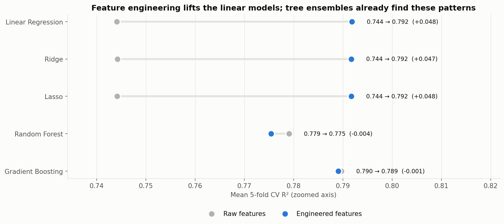
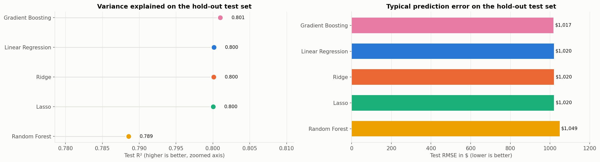

# MSCS 634 – Project Deliverable 2: Regression Modeling and Performance Evaluation

**Project:** Advanced Data Mining for Data-Driven Insights and Predictive Modeling

**Authors:**
- Pranavi Balakulla
- Sandeep Reddy Banda
- Sowmya Cheruku
- Vineela Reddy Karnatakam

**Dataset:** IBM Telco Customer Churn – cleaned version from [Deliverable 1](https://github.com/pranavibalakulla/MSCS_634_Project_Deliverable_1)

---

## Repository Contents

```
MSCS_634_Project_Deliverable_2/
├── Deliverable2_Regression_Modeling.ipynb   # Notebook: target choice, feature engineering, models, CV, evaluation
├── README.md                                # This file
├── requirements.txt                         # Python packages needed to run the notebook
├── telco_churn_cleaned.csv                  # Cleaned dataset produced in Deliverable 1
└── Images/                                  # All charts exported by the notebook
```

**To run:** `pip install -r requirements.txt`, open the notebook in Jupyter and choose *Run All*.

---

## Dataset Summary

The cleaned Telco Customer Churn dataset from Deliverable 1 contains **7,043 customers** and **24 columns**:
demographics, the services each customer buys, contract and billing details, `tenure`, `MonthlyCharges`,
`TotalCharges` and `Churn`. It has no missing values.

## Modeling Process

### 1. Choosing the target (and avoiding leakage)

**Business question:** *How much revenue is a customer worth, given their plan and profile?*
**Target:** `TotalCharges` (lifetime revenue to date, mean ≈ \$2,280, right-skewed).

Before modeling we ran sanity checks with 5-fold cross-validation:

| Candidate | CV R² | Decision |
|---|---|---|
| `MonthlyCharges` from services (the Deliverable 1 plan) | 0.999 | Rejected: the bill is a price-list lookup, so every model ties |
| `TotalCharges` with `tenure` as a feature | 0.999 | Rejected: **target leakage** (`TotalCharges ≈ tenure × MonthlyCharges`) |
| **`TotalCharges` from plan + profile, without tenure** | 0.748 | **Chosen:** a realistic prediction problem |

`tenure`, `tenure_group`, `Churn` and `customerID` are excluded from the predictors.

### 2. Feature engineering

The EDA showed that each dollar of monthly price is worth very different lifetime revenue depending on the contract
(≈ \$21 month-to-month, \$47 one-year, \$61 two-year). A single linear slope cannot capture that, so we engineered
**11 new features** on top of the 21 raw (one-hot + `MonthlyCharges`) features:

- **Count features:** `NumServices`, `ProtectionAddons`, `StreamingAddons`
- **Combined flags:** `AutoPay`, `FamilyAccount`
- **Interaction terms:** `Contract × MonthlyCharges` (2), `AutoPay × MonthlyCharges`, `FamilyAccount × MonthlyCharges`,
  `NumServices × MonthlyCharges`
- **Polynomial term:** `MonthlyCharges²`

### 3. Models and evaluation

- **Models:** Linear Regression, Ridge (`RidgeCV`), Lasso (`LassoCV`), Random Forest, Gradient Boosting. Each model
  runs inside a pipeline with `StandardScaler`.
- **Evaluation:** an 80/20 train/test split, then **5-fold cross-validation** on the training set for every model on
  both feature sets. The final scores come from the untouched test set.
- **Metrics:** R², MSE, RMSE and MAE.

---

## Evaluation Results

**Effect of feature engineering (5-fold CV R²):**

| Model | Raw features | Engineered features | Change |
|---|---|---|---|
| Linear Regression | 0.744 | **0.792** | +0.048 (RMSE −\$112) |
| Ridge | 0.744 | **0.792** | +0.047 |
| Lasso | 0.744 | **0.792** | +0.048 |
| Random Forest | 0.779 | 0.775 | −0.004 |
| Gradient Boosting | 0.790 | 0.789 | −0.001 |



**Hold-out test set (engineered features):**

| Model | CV R² | Test R² | Test MSE | Test RMSE | Test MAE |
|---|---|---|---|---|---|
| **Gradient Boosting** | 0.789 | **0.801** | 1,035,222 | **\$1,017.5** | **\$731.6** |
| **Ridge** | **0.792** | 0.800 | 1,039,888 | \$1,019.7 | \$736.5 |
| Linear Regression | 0.792 | 0.800 | 1,039,729 | \$1,019.7 | \$738.0 |
| Lasso | 0.792 | 0.800 | 1,040,318 | \$1,020.0 | \$736.9 |
| Random Forest | 0.775 | 0.789 | 1,100,043 | \$1,048.8 | \$740.2 |



### Which model performed best?

- **Gradient Boosting** scored highest on the test set, but only by **0.001 R²** (about \$2 of RMSE). That is a
  practical tie with the linear models.
- **Recommended: Ridge regression with engineered features.** It matches Gradient Boosting's accuracy, has the best
  cross-validated R², and its train, CV and test scores are nearly identical (0.795 / 0.792 / 0.800), so it
  generalises well. It is also fast and easy to explain.
- **Random Forest** generalised worst: train R² 0.877 vs test 0.789, which shows some overfitting.

---

## Key Insights

1. **Feature engineering mattered more than the algorithm.** It lifted the linear models by +0.048 R². The top four
   models differ by less than 0.002.
2. **Contract length multiplies customer value.** The contract × price interactions are among the strongest
   predictors in both Lasso and Gradient Boosting.
3. **Bundled, higher-paying customers are the most valuable.** `NumServices × MonthlyCharges` is the most important
   feature.
4. **Two-year customers are the most predictable** (mean absolute error ≈ \$562, vs ≈ \$789 for the other contracts).
5. **Remaining error is substantial** (RMSE ≈ 45% of mean revenue). Lifetime revenue depends mainly on *how long* a
   customer stays, which plan and profile only partly reveal. That is the churn question in Deliverable 3.
6. **Regularisation changed little** (Ridge α ≈ 5, Lasso α ≈ 0.10) because there are many more rows than features.
   Lasso confirmed that 4 features were redundant.

**Practical use:** combining predicted customer value with the churn probability from Deliverable 3 gives
**revenue at risk**, so retention spending can go to customers who are both valuable and likely to leave.

---

## Challenges and How They Were Addressed

| Challenge | Solution |
|---|---|
| The planned target (`MonthlyCharges`) turned out to be trivially predictable (R² 0.999) | Tested candidate targets first and switched to lifetime revenue, documenting why |
| Target leakage: `tenure` almost fully determines `TotalCharges` | Removed `tenure`, `tenure_group` and `Churn` from the predictors |
| A linear model gives every customer the same price slope | Engineered contract × price interactions and count features, and measured the gain against the raw features |
| Multicollinearity between dummies, price and service counts | `drop_first` encoding, Ridge and Lasso with cross-validated α, and judging models by predictions rather than single coefficients |
| Fair evaluation without leakage | Locked 20% test set, 5-fold CV on training data only, and scaling fitted inside each pipeline |
| Library version differences (e.g. a `LassoCV` argument was renamed) | Wrote code that works across scikit-learn versions and tested it on old and new releases |
